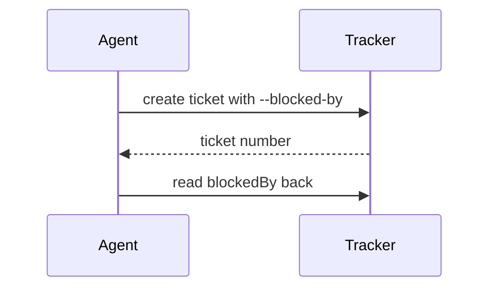

# Visualize

Choose the smallest figure that makes the point, put it next to the sentence it supports, and keep only the parts that answer the current question: the calls, files, states, and boundaries that matter here.

## Choose the form

| What you show | Form |
|---|---|
| Logic or an algorithm | Pseudocode |
| What calls what at runtime | Call tree |
| UI structure | Component tree, with the state and module boundaries that matter |
| What each file or folder is for, or a broad refactor | Shallow file tree, one comment per entry |
| Components talking to each other, or data moving between stages | Sequence diagram or flowchart |
| States and the events that move between them | State diagram |
| A change to any of the above | The same form, written as a diff with `+` and `-` lines |
| Options side by side, or before and after | A table, or two panels next to each other |
| Order in time | A timeline |
| Numbers | A table; a chart only when the shape of the numbers is the point |
| Too dense for text, several linked figures, or something the reader should step through | An HTML page |

A call tree:

```text
handlePush
  readOutgoingCommits
  checkAttribution
    stripLines        # same rules as the commit-msg hook
  reportFixCommand
```

A change to a file tree:

```diff
 skills/
 ├── decision-notes/
+├── explain/         # explains a subject with figures and a quiz
+├── visualize/       # draws the figures
 └── pr/
```

Show a whole block instead of a diff when most of it is new, or when the reader needs the complete target shape to copy.

A sequence diagram:



## In the reply

Put text forms in fenced blocks: `text` for trees and pseudocode, `diff` for changes, and `mermaid` where the viewer renders it, or else a text equivalent. Use one figure per point, with a sentence or two around it.

## As a page

Write an HTML page when the form table says so, or when another skill asks for one. [references/page.md](references/page.md) covers how to build, open, and check it.

Every file this skill writes, the page and anything the page needs, goes to a temporary directory and never into the repository or the working directory: the scratchpad directory your harness provides, if any, or else a `visualize/` folder in the system temp directory (`%TEMP%` on Windows, `$TMPDIR` or `/tmp` elsewhere). Name the page after its topic, `<topic-slug>.html`, and overwrite it when the same topic comes back, so pages do not pile up. Give the user the page's full path.
